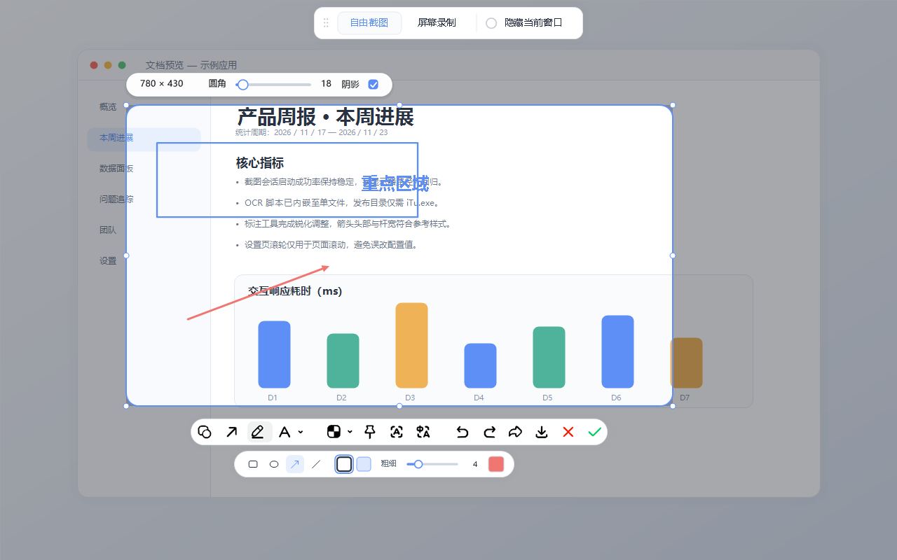
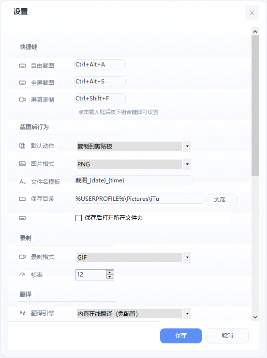
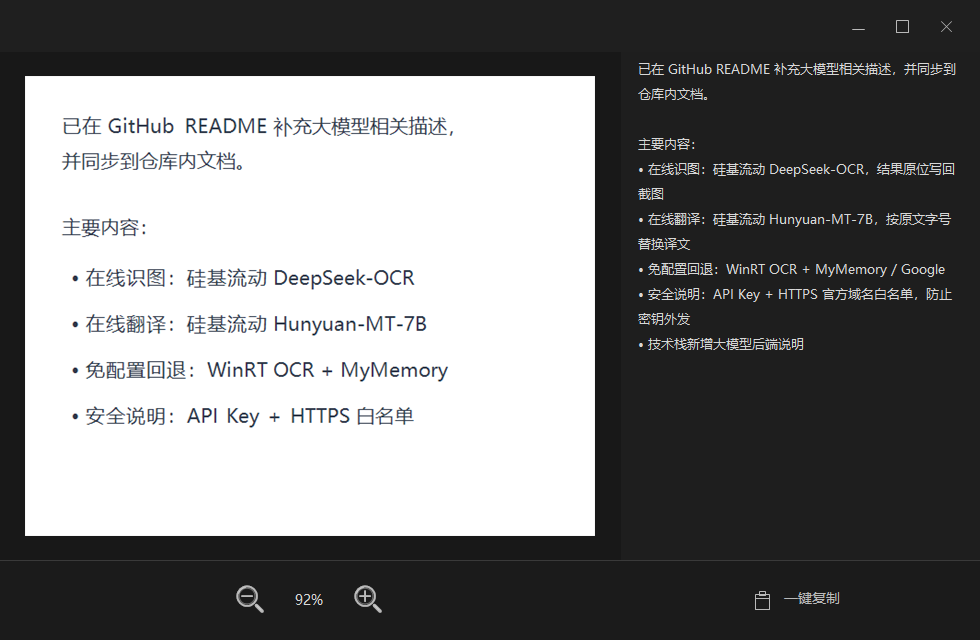

# iTu — Windows 截图工具

[](LICENSE)
[](https://dotnet.microsoft.com/)

一个 Windows 桌面截图工具，复刻 QQ 截图工具的核心交互体验。

可选接入大模型：在线识图使用 **DeepSeek-OCR**，翻译可使用 **Hunyuan-MT-7B**；识图结果弹出可复制的双栏面板，译文原位写回截图。


---

## 🖼️ 界面预览

### 截图主界面



### 设置界面



### 文字提取结果（复制）



左侧原图支持拖拽平移与滚轮缩放；右侧文字可选中复制，底部「一键复制」复制全文。

---

## ✨ 功能特性

### 截图

| 功能 | 说明 |
|---|---|
| 🖱️ 自由截图 | 拖拽框选，实时显示选区坐标与尺寸 |
| 🪟 窗口截图 | 鼠标悬停整窗高亮（原亮度预览 + 主色描边 + 标题牌「程序名 · 窗口标题 · 宽 × 高」），单击即捕获 |
| 🖥️ 全屏截图 | 顶部功能条「截图 → 全屏截图」，或 `Ctrl+Alt+S` 热键 |
| 🚪 右键退出 | 截图界面任意位置点右键立即退出 |

### 标注与编辑

- 单图层界面：选区、遮罩、胶囊工具栏、圆角工具条、次级胶囊、颜色弹层、顶部功能条
- 主胶囊 14 个格位：形状 / 箭头 / 画笔 / 文字 / 马赛克 / 钉图 / 识图 / 翻译 / 撤销 / 重做 / 转发 / 保存 / 取消 / 复制并关闭
- 圆角条：尺寸显示、圆角滑杆、阴影开关
- 顶部功能条：六点手柄（可拖）、截图下拉菜单（自由 / 窗口 / 全屏）、隐藏当前窗口选择框

### 高级功能

| 功能 | 实现方式 |
|---|---|
| 🔍 文字提取（OCR） | 默认走硅基流动 **DeepSeek-OCR** 大模型；未配置 Key 或失败时回退系统 WinRT `OcrEngine`（PowerShell 5.1，中英文）。识别后弹出双栏结果面板：左侧原图可缩放/拖动/滚轮缩放，右侧文字按原图排版重建、可选中复制并支持一键复制；本地 OCR 优先简体中文引擎并自动放大预处理，同时保留自动复制到剪贴板，不修改原截图 |
| 🌐 翻译 | 可切换硅基流动 **Hunyuan-MT-7B** 翻译大模型；免配置模式走 MyMemory / Google 公共端点。译文直接写回选区画面，字号对齐原图 |
| 🎬 屏幕录制 | 区域录制 → GIF（内置编码器）/ MP4（ffmpeg）；支持暂停/继续、取消、Esc 停止 |

### 大模型能力（可选）

| 能力 | 模型 / 服务 | 说明 |
|---|---|---|
| 在线识图 | `deepseek-ai/DeepSeek-OCR`（硅基流动） | 多模态 OCR 大模型，适合复杂版面与中英混排；逐行结果在双栏面板中展示，可选中复制并一键复制 |
| 在线翻译 | `tencent/Hunyuan-MT-7B`（硅基流动） | 通过 OpenAI 兼容接口调用，译文按原文字号与位置替换 |
| 免配置回退 | WinRT OCR + MyMemory / Google | 不填 API Key 也能用；识图失败自动回退本地 WinRT |
| 凭证安全 | API Key + HTTPS 白名单 | 接口地址仅允许 SiliconFlow 官方 HTTPS 域名，防止密钥被自定义端点外发 |

在「设置 → 硅基流动 SiliconFlow」填入 API Key，并把翻译引擎切到「硅基流动」、
识别引擎切到「在线 DeepSeek-OCR」即可启用；不配置则保持免配置通道。

### 系统集成

- 托盘常驻、全局热键（默认 `Ctrl+Alt+A` 自由截图 / `Ctrl+Alt+S` 全屏截图 / `Ctrl+Shift+F` 录制）
- 快捷键自定义、开机自启、单实例（重复启动即唤起截图）

---

## 🚀 快速开始

### 下载即用

| 版本 | 目录 | 体积 | 说明 |
|---|---|---|---|
| **独立版**（推荐） | `dist/iTu-standalone/` | 47 MB | 内含 .NET 运行时，任何 Windows 10/11 双击即用 |
| 轻量版 | `dist/iTu/` | 490 KB | 需要系统已安装 .NET 10 Desktop Runtime |


### 从源码构建

```bash
# 构建
dotnet build -c Release

# 发布轻量版（需系统已装 .NET 10 Desktop Runtime）
dotnet publish -c Release -r win-x64 -p:SelfContained=false \
  -p:PublishSingleFile=true -p:DebugType=none -o dist/iTu

# 发布独立版（零依赖）
dotnet publish -c Release -r win-x64 -p:SelfContained=true \
  -p:PublishSingleFile=true -p:EnableCompressionInSingleFile=true \
  -p:DebugType=none -o dist/iTu-standalone
```

#### 一键发布（推荐）

运行 `iTu\publish.cmd`，自动完成：检查运行实例 → 清旧 dist → 发布轻量版 → 发布独立版 → 构建快捷方式工具 → 刷新桌面图标。

---

## 🏗️ 代码结构

```
iTu/
├── Program.cs               # 入口（单实例 + 托盘 + 全局热键）
├── AppContext.cs            # 应用上下文
├── SettingsForm.cs          # 设置面板
├── RecordPanel.cs           # 录制面板
├── Core/
│   ├── ScreenCapture.cs     # 屏幕捕获
│   ├── ScreenRecorder.cs    # 屏幕录制（GIF/MP4）
│   ├── OcrService.cs        # OCR（PowerShell 后端）
│   ├── TranslateService.cs  # 翻译
│   ├── GifEncoder.cs        # 内置 GIF 编码器
│   ├── Annotation.cs        # 标注绘制
│   ├── HotkeyManager.cs     # 全局热键
│   └── ...
└── Ui/
    ├── OverlaySession.cs    # 截图会话（选区/拖动/缩放）
    ├── OverlayForm.cs       # 遮罩窗体
    ├── QuickBar.cs          # 顶部功能条
    ├── ToolFlyout.cs        # 工具飞层
    ├── PillToolbar.cs       # 胶囊工具栏
    └── ...
```

测试/辅助项目：`ocrgui`（UI 回归）、`inkcheck`（墨迹单测）、`verify`（核心逻辑验证）、`auditgui`、`guicheck`、`qa` 等。

---

## 📄 许可证

本项目采用 [MIT License](LICENSE)。

---

## 📝 技术栈

- **语言**：C# / .NET 10（Windows Forms）
- **零第三方运行时依赖**：本地 OCR 走系统自带 PowerShell + WinRT，GIF 用内置编码器；大模型走 HTTPS 接口，无需下载模型文件
- **大模型后端**：DeepSeek-OCR（识图）/ Hunyuan-MT-7B（翻译），经 SiliconFlow OpenAI 兼容接口调用，可回退到本地与公共端点
- **构建**：`dotnet build` / `dotnet publish`
